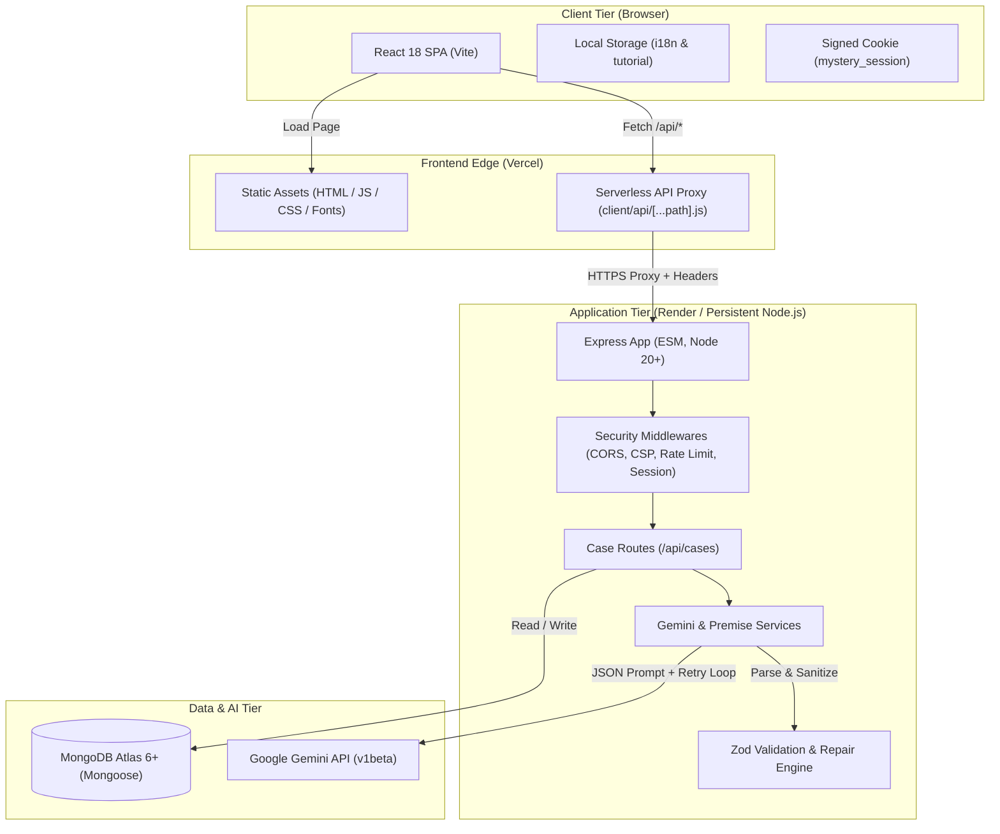
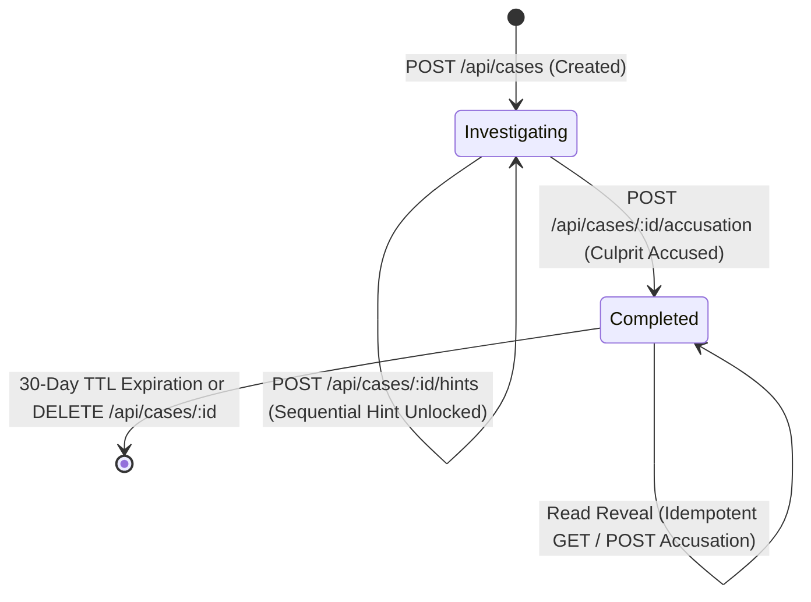

# System Architecture & Technical Specifications — AI Mystery Room

**Document Version:** 2.1  
**Project:** AI Mystery Room  
**Status:** Implemented Baseline  
**Architecture Style:** Split-tier SPA + Dedicated Express API + Managed MongoDB + Gemini Generative AI  

---

## 1. High-Level Architectural Topology

---

## 2. Tier Breakdown & Technology Stack

### 2.1 Client Tier (Frontend)
- **Framework & Tooling:** React 18.3, Vite 6.0, React Router DOM 7.1.
- **Styling:** Modular CSS tokens (`styles.css`), CSS grid, flexbox, zero external heavyweight UI frameworks (no Tailwind/Bootstrap runtime bloat).
- **Icons:** `lucide-react` (feather-light tree-shakeable SVG icons).
- **Client Storage:**
  - `localStorage['mystery-locale']`: Persisted interface language (`en`, `hi`, `hinglish`).
  - `localStorage['mystery-tutorial-complete']`: Dismissal state of the first-time onboarding card.
- **Network Client:** Native `fetch` with `credentials: 'include'` to pass the `mystery_session` HTTP cookie.

### 2.2 Edge & Proxy Tier (Vercel)
- **Static Hosting:** Serves pre-compiled production bundles (`client/dist`).
- **Serverless API Proxy (`client/api/[...path].js`):**
  - Intercepts all `/api/*` traffic originating from the client.
  - Proxies requests to the backend HTTPS origin defined by `API_ORIGIN`.
  - Preserves client request headers (`cookie`, `x-idempotency-key`, `origin`).
  - Preserves upstream response headers (`set-cookie`, `cache-control`, `etag`).
  - **Purpose:** Solves cross-origin cookie restrictions on modern browsers by serving both SPA and API endpoints under the same parent domain.

### 2.3 Application Server Tier (Node.js & Express)
- **Runtime:** Node.js 20+ executing native ECMAScript Modules (`"type": "module"`).
- **Server Framework:** Express 4.21.
- **Entry Points:**
  - `server/src/server.js`: Connects to MongoDB, binds port, and boots listener.
  - `server/src/app.js`: Express configuration, middleware pipeline, route registration.
- **Service Layer:**
  - `geminiService.js`: Direct HTTP transport with Google Generative Language API, timeout management, thinking configuration, schema validation, and bounded retry/repair loop.
  - `randomPremises.js`: Curated, thematic premise generator for random mystery selection.

### 2.4 Data Tier (MongoDB & Gemini API)
- **MongoDB 6+:**
  - Connection managed via Mongoose 8.9.
  - Support for custom DNS resolvers (`MONGODB_DNS_SERVERS`) for containerized environments where DNS SRV records fail to resolve.
  - Automatic collection cleanup via 30-day MongoDB TTL indexes on `expiresAt`.
- **Google Gemini API:**
  - Generative Language API endpoint: `/v1beta/models/{model}:generateContent`.
  - Configurable thinking levels (`minimal`, `low`, `medium`, `high`) for Gemini 3+ models.
  - Structured JSON response enforcement (`responseMimeType: 'application/json'`).

---

## 3. Data Segregation & Security Boundaries

```mermaid
flowchart LR
    subgraph ClientVisible ["Public Payload (MysteryCase)"]
        Title["Title & Narrative Context"]
        Suspects["Suspects Dossier (Profiles & Alibis)"]
        Evidence["Evidence Locker (Descriptions & Content)"]
        Timeline["Chronological Timeline"]
        Notes["Player Notes & Reviewed Clues"]
    end

    subgraph IsolatedStorage ["Private Storage (CaseSolution)"]
        CulpritId["Culprit ID & Name"]
        Motive["Motive & Method"]
        FullExplanation["Canonical Truth Narrative"]
        ClueMap["Evidence Reasoning & Implication Tags"]
        PrivateSolution["Internal Solution String"]
    end

    ClientVisible -.->|Accusation Evaluated On Server| IsolatedStorage
    IsolatedStorage ==>|Disclosed Only After Valid Accusation| ClientVisible
```

### 3.1 Strict Separation of Solution
To prevent data leaks and inspect-element exploitation:
1. `MysteryCase` collection stores public case data visible to players during deduction.
2. `CaseSolution` collection stores the secret canonical ground truth.
3. The server's `publicCase()` serializer excludes all fields from `CaseSolution`.
4. Only when `POST /api/cases/:id/accusation` receives a valid suspect ID does the server read `CaseSolution` and return the reveal payload to the client.

### 3.2 State Transition Machine

- **Locking on Completion:** Once `submittedSuspectId` is set, the case transitions to `completed`. Subsequent `PATCH /progress` calls are rejected with `409 CASE_SUBMITTED`, and hint requests are rejected with `409 CASE_COMPLETED`.
- **Atomic Accusation:** MongoDB's atomic `findOneAndUpdate` with `{ submittedSuspectId: null }` prevents race conditions or double-accusation attempts.

---

## 4. Security Architecture & Middlewares

### 4.1 Middleware Pipeline in `app.js`
1. **Disable `x-powered-by`:** Eliminates server fingerprinting.
2. **Reverse Proxy Trust:** `app.set('trust proxy', env.trustProxyHops)` safely decodes client IPs behind load balancers.
3. **Request Tracing & Headers:**
   - Generates unique UUIDv4 per request (`req.id` / `X-Request-Id`).
   - Sets strict defensive headers:
     - `X-Content-Type-Options: nosniff`
     - `X-Frame-Options: DENY`
     - `Referrer-Policy: no-referrer`
     - `Permissions-Policy: camera=(), microphone=(), geolocation=()`
     - `Cache-Control: no-store`
     - `Content-Security-Policy: default-src 'none'; frame-ancestors 'none'; base-uri 'none'`
4. **CORS & Origin Validation:**
   - Checks `Origin` against `CLIENT_ORIGIN` for all state-mutating HTTP methods (`POST`, `PUT`, `PATCH`, `DELETE`).
   - Rejects unlisted origins with `403 ORIGIN_NOT_ALLOWED`.
5. **JSON Body Parser:** Strict limit of `32kb` prevents denial-of-service via oversized payloads.
6. **Session Extractor:** Reads and verifies `mystery_session` signed cookie.

---

## 5. Reliability, Concurrency & Rate Limiting

### 5.1 Concurrency Gate (`generationConcurrencyLimit`)
- Tracks active LLM generation requests in memory (`activeGenerations`).
- If active count reaches `MAX_CONCURRENT_GENERATIONS` (default 2), immediate `429 GENERATION_BUSY` with `Retry-After: 3` is returned.
- Protects Node.js event loop and backend memory from LLM connection backpressure.

### 5.2 Rate Limiters (`express-rate-limit`)
- **Generation:** `CASE_GENERATION_RATE_LIMIT` (default 5 requests per 60 mins).
- **Progress:** `CASE_PROGRESS_RATE_LIMIT` (default 120 updates per 15 mins).
- **Accusations:** `CASE_ACCUSATION_RATE_LIMIT` (default 10 submissions per 15 mins).
- **Hints:** `CASE_HINT_RATE_LIMIT` (default 12 requests per 15 mins).

### 5.3 Bounded Gemini Retries & Self-Repair
- Maximum **3 attempts** per case generation.
- Handles HTTP 408, 429, 5xx, timeouts, and JSON syntax failures.
- Automatically injects specific Zod validation errors back into the repair prompt on subsequent attempts.
- Respects upstream `Retry-After` headers, bounding waits to `GEMINI_MAX_RETRY_DELAY_MS` (default 30s).

