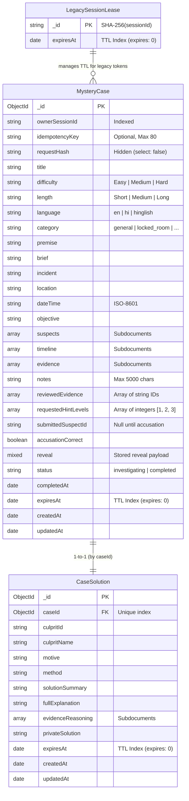

# Database Schema & Data Models — AI Mystery Room

**Document Version:** 2.1  
**Project:** AI Mystery Room  
**Status:** Implemented Baseline  
**Database Engine:** MongoDB 6+  
**Object Data Modeling (ODM):** Mongoose 8.9  

---

## 1. Overview & Data Architecture

AI Mystery Room utilizes MongoDB as its primary persistence engine. The schema design reflects two critical architectural constraints:
1. **Security Isolation:** Player-facing game data is isolated from the ground truth solution.
2. **Ephemeral Lifecycle:** Anonymous gameplay data automatically expires after 30 days using MongoDB TTL (Time-To-Live) indexes, keeping storage overhead bounded.



---

## 2. Model Specifications

### 2.1 `MysteryCase` (`server/src/models/MysteryCase.js`)
Stores the active state of an investigation and all player-visible narrative components.

#### Schema Definition
```javascript
const suspectSchema = new mongoose.Schema({
  id: String,
  name: String,
  role: String,
  profile: String,
  relationship: String,
  alibi: String,
}, { _id: false });

const timelineSchema = new mongoose.Schema({
  time: String,
  event: String,
}, { _id: false });

const evidenceSchema = new mongoose.Schema({
  id: String,
  type: String, // 'message' | 'statement' | 'document' | 'image' | 'cctv'
  title: String,
  description: String,
  content: String,
  timestamp: String,
  source: String,
  suspectIds: [String],
}, { _id: false });

const mysteryCaseSchema = new mongoose.Schema({
  ownerSessionId: { type: String, required: true, index: true },
  idempotencyKey: { type: String, default: undefined, maxlength: 80 },
  requestHash: { type: String, default: undefined, maxlength: 64, select: false },
  title: { type: String, required: true },
  difficulty: { type: String, enum: ['Easy', 'Medium', 'Hard'], required: true },
  length: { type: String, enum: ['Short', 'Medium', 'Long'], required: true },
  language: { type: String, enum: ['en', 'hi', 'hinglish'], default: 'en', required: true },
  category: { 
    type: String, 
    enum: ['general', 'locked_room', 'art_theft', 'disappearance', 'historical', 'espionage'], 
    default: 'general', 
    required: true 
  },
  premise: { type: String, required: true },
  brief: { type: String, required: true },
  incident: { type: String, required: true },
  location: { type: String, required: true },
  dateTime: { type: String, required: true },
  objective: { type: String, required: true },
  suspects: { type: [suspectSchema], default: [] },
  timeline: { type: [timelineSchema], default: [] },
  evidence: { type: [evidenceSchema], default: [] },
  notes: { type: String, default: '' },
  reviewedEvidence: { type: [String], default: [] },
  requestedHintLevels: { type: [Number], default: [] },
  submittedSuspectId: { type: String, default: null },
  accusationCorrect: { type: Boolean, default: null },
  reveal: { type: mongoose.Schema.Types.Mixed, default: null },
  status: { type: String, enum: ['investigating', 'completed'], default: 'investigating', index: true },
  completedAt: { type: Date, default: null },
  expiresAt: { type: Date, index: { expires: 0 } },
}, { timestamps: true, minimize: false });
```

#### Indexes
1. `ownerSessionId: 1` — Fast retrieval of cases belonging to a specific anonymous browser session.
2. `ownerSessionId: 1, idempotencyKey: 1` — **Unique compound partial index** (`partialFilterExpression: { idempotencyKey: { $type: 'string' } }`). Prevents double-creation when the client retries generation.
3. `status: 1` — Fast filtering between active and solved investigations.
4. `expiresAt: 1 (expires: 0)` — MongoDB TTL background thread sweeps and deletes documents once `Date.now() >= expiresAt`.

---

### 2.2 `CaseSolution` (`server/src/models/CaseSolution.js`)
Houses the secret canonical truth of the mystery. It is strictly forbidden from being returned in standard case fetch queries.

#### Schema Definition
```javascript
const caseSolutionSchema = new mongoose.Schema({
  caseId: { type: mongoose.Schema.Types.ObjectId, required: true, unique: true, index: true },
  culpritId: { type: String, required: true },
  culpritName: String,
  motive: String,
  method: String,
  solutionSummary: String,
  fullExplanation: String,
  evidenceReasoning: [{
    evidenceId: String,
    explanation: String,
    implication: String, // 'supports_culprit' | 'weakens_suspect' | 'red_herring'
  }],
  privateSolution: String,
  expiresAt: { type: Date, index: { expires: 0 } },
}, { timestamps: true });
```

#### Implication Enum Types
- `supports_culprit`: Direct or circumstantial clue incriminating the true culprit. Must have at least 2 independent clues.
- `weakens_suspect`: Evidence exonerating or clearing an innocent suspect. Must have at least 1 clue.
- `red_herring`: A misleading lead that looks suspicious but resolves innocently. Count constrained by difficulty (Easy: 0–1, Medium: 1–2, Hard: 2–3).

---

### 2.3 `LegacySessionLease` (`server/src/models/LegacySessionLease.js`)
Supports backwards compatibility for v1 unversioned session cookies.

#### Schema Definition
```javascript
const legacySessionLeaseSchema = new mongoose.Schema({
  _id: { type: String, required: true }, // SHA-256 hash of the sessionId
  expiresAt: { type: Date, required: true, expires: 0 },
}, { versionKey: false });
```

---

## 3. Data Lifecycle, TTL & Deletion Workflows

### 3.1 Initial Creation & Expiration Timestamp
When a case is created via `POST /api/cases`:
```javascript
const expiresAt = new Date(Date.now() + 30 * 24 * 60 * 60 * 1000); // +30 days
```
Both `MysteryCase` and `CaseSolution` receive identical `expiresAt` timestamps.

### 3.2 Manual User Deletion
When a player deletes an investigation from the library (`DELETE /api/cases/:id`):
```javascript
const doc = await MysteryCase.findOneAndDelete({ _id: req.params.id, ownerSessionId: req.sessionId });
if (doc) {
  await CaseSolution.deleteOne({ caseId: doc._id });
}
```
Ensures both public and private records are pruned synchronously.

### 3.3 Atomic Accusation Write Pattern
To prevent race conditions where a user clicks "Accuse" twice rapidly:
```javascript
const updated = await MysteryCase.findOneAndUpdate(
  { _id: doc._id, ownerSessionId: req.sessionId, submittedSuspectId: null },
  { 
    $set: { 
      submittedSuspectId: parsed.data.suspectId, 
      accusationCorrect: parsed.data.suspectId === solution.culpritId, 
      status: 'completed', 
      completedAt: new Date() 
    } 
  },
  { new: true }
);
```
If two requests arrive simultaneously, exactly one matches `{ submittedSuspectId: null }` and mutates the document; the second request reads the existing record and returns the cached reveal idempotently.

---

## 4. Connection Configuration & DNS SRV Overrides

In `server/src/config/database.js`:
- Configures `serverSelectionTimeoutMS: 8000` to prevent hanging requests when the cluster is cold or unreachable.
- Supports `MONGODB_DNS_SERVERS`: When deploying to containerized hosts (e.g., Render) where system resolv.conf cannot parse `mongodb+srv://` TXT/SRV records, Node's `dns.setServers()` explicitly routes DNS queries through reliable public resolvers (e.g., `8.8.8.8,1.1.1.1`).

