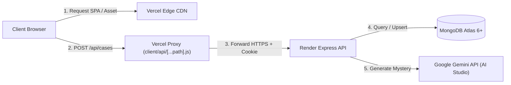

# External Integrations & Cloud Services — AI Mystery Room

**Document Version:** 2.1  
**Project:** AI Mystery Room  
**Status:** Implemented Baseline  

---

## 1. External Integrations Architecture

AI Mystery Room relies on three primary external platforms:
1. **Google Gemini API:** Generative AI engine for mystery synthesis and reveal translation.
2. **MongoDB Atlas:** Distributed cloud database persistence with automated TTL document pruning.
3. **Vercel Serverless Edge:** Edge CDN and reverse API proxy preserving cross-origin session cookies.



---

## 2. Google Gemini API Integration

### 2.1 API Endpoint & Protocol
- **Endpoint:** `https://generativelanguage.googleapis.com/v1beta/models/{model}:generateContent`
- **Method:** `POST`
- **Authentication:** HTTP Request Header `x-goog-api-key: env.geminiApiKey`
- **Payload Protocol:**
  ```json
  {
    "systemInstruction": {
      "parts": [{ "text": "System prompt text..." }]
    },
    "contents": [
      {
        "role": "user",
        "parts": [{ "text": "User scenario prompt..." }]
      }
    ],
    "generationConfig": {
      "responseMimeType": "application/json",
      "thinkingConfig": { "thinkingLevel": "low" }
    }
  }
  ```

### 2.2 Model Selection & Thinking Budget
Configured via `.env`:
- `GEMINI_MODEL`: The model identifier (e.g., `gemini-2.5-flash`, `gemini-3.5-flash-lite`, `gemini-3.8-flash`).
- `GEMINI_THINKING_LEVEL`: For reasoning models (`gemini-3+`), configures thinking level (`minimal`, `low`, `medium`, `high`). Defaults to `low` to balance low latency (<25s) with deduction coherence.

### 2.3 Provider Quota & Backoff Management
In `server/src/services/geminiService.js`:
- Reads and parses the upstream `Retry-After` header.
- Calculates exponential backoff: `1000 * 2^attempt + jitter`.
- Bounds sleep time to `GEMINI_MAX_RETRY_DELAY_MS` (default 30s). If Gemini asks for a longer wait (e.g., 45s), the server skips the retry immediately and returns an informative `429 AI_RATE_LIMITED` to the player with the upstream `Retry-After` value.

---

## 3. MongoDB Atlas Integration

### 3.1 Connection Options & Resilience
In `server/src/config/database.js`:
```javascript
const options = { serverSelectionTimeoutMS: 8000 };
await mongoose.connect(env.mongoUri, options);
```
- Sets `serverSelectionTimeoutMS: 8000` to prevent unhandled promise hangs during connection drops.
- Logs structured events: `mongodb_connected` or `mongodb_connection_failed`.

### 3.2 DNS SRV Resolution Override (`MONGODB_DNS_SERVERS`)
In certain cloud container environments (such as Render or Alpine Linux Docker containers), local DNS resolvers fail to query `mongodb+srv://` TXT records:
```javascript
if (env.mongoDnsServers.length) {
  dns.setServers(env.mongoDnsServers);
}
```
Setting `MONGODB_DNS_SERVERS=8.8.8.8,1.1.1.1` forces Node.js to use Google and Cloudflare public DNS resolvers, bypassing faulty host resolver daemons.

---

## 4. Vercel Serverless API Proxy

### 4.1 Problem Solved
Modern browsers restrict third-party cross-site cookies (`SameSite=Lax` / `None`). If the frontend is hosted at `https://mystery-room.vercel.app` and the backend is hosted at `https://mystery-room-api.onrender.com`, standard `fetch()` calls across different domains can drop the session cookie or trigger browser security warnings.

### 4.2 Solution: Edge Proxy (`client/api/[...path].js`)
- Runs as a lightweight serverless handler on the Vercel site origin.
- Forwards `/api/*` requests directly to `API_ORIGIN`.
- Forwards request headers: `accept`, `content-type`, `cookie`, `origin`, `user-agent`, `x-idempotency-key`.
- Forwards response headers: `set-cookie`, `cache-control`, `content-type`, `etag`, `vary`.
- **Timeout Protection:** Configured with `maxDuration: 60` to ensure that upstream Gemini AI case generation (which can take 5–15s under model reasoning and retry loops) never triggers Vercel's default 10s gateway timeout.
- **Outcome:** The browser communicates exclusively with its own domain (`/api/*`), preserving the HttpOnly `mystery_session` cookie seamlessly.

### 4.3 Validation Guardrails
`client/vercel-config.js` and `client/api/[...path].js` enforce strict rules on `API_ORIGIN`:
- Must be a valid HTTPS URL.
- Must not contain embedded credentials (`user:pass`).
- Must not contain a URL path, query string, or hash fragment.

---

## 5. Render Web Service (Backend Host)

The Express backend is engineered as a long-running, persistent process:
- **Root Directory:** `server`
- **Build Command:** `npm ci`
- **Start Command:** `npm start`
- **Health Check Endpoint:** `GET /api/health`
- **Port Binding:** Automatically reads `PORT` from the environment.
- **Graceful Error Handling:** Logs structured JSON to stdout for Render log aggregation.

