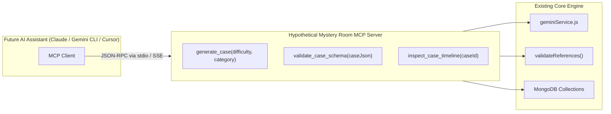

# Model Context Protocol (MCP) Evaluation & Extensibility — AI Mystery Room

**Document Version:** 2.1  
**Project:** AI Mystery Room  
**Status:** **`[Not Applicable / Not Implemented in Existing Codebase]`**  

---

## 1. Current Applicability Assessment

### Status: NOT APPLICABLE
The **Model Context Protocol (MCP)** is an open standard designed to enable AI assistants to securely connect to external tools, data sources, and computational environments.

As of the current production-ready baseline (Version 2.1), **AI Mystery Room does not implement, require, or depend on any MCP servers or MCP client runtimes.**

### Why MCP is Not in the Existing Codebase
1. **Direct Structured API Pipeline:** The application communicates directly with the Google Gemini API using native HTTPS fetch requests (`fetchTransport` in `geminiService.js`).
2. **Self-Contained World Building:** The mystery synthesis process relies purely on in-context generation constrained by a prompt template (`case-v2`), seed data (`randomPremises.js`), and deterministic Zod validation rules.
3. **No External Tool Calls Required:** The game engine does not require external web browsing, code execution, file system querying, or third-party API tool calls during case generation or gameplay.
4. **Deterministic Security Boundary:** Introducing dynamic agentic tool calling during mystery generation could introduce non-deterministic execution paths, increasing latency and expanding the attack surface.

---

## 2. Architectural Analysis: Potential Future Applications

While MCP is non-applicable to the MVP, this document outlines where MCP *could* theoretically fit in future post-MVP enterprise or developer tooling phases:

### Potential Use Cases
1. **Developer Tooling & Testing Agent:**
   An internal MCP server could allow AI developer tools (such as Antigravity, Claude Code, or Cursor) to programmatically generate test cases, run schema validation stress tests, or inspect database consistency via standard MCP tool calls.
2. **External Knowledge Grounding (Historical Mysteries):**
   In a specialized "Historical Fiction" expansion, an MCP server connected to a vetted historical encyclopedia or museum database could provide verified period-accurate details (e.g., Victorian-era London train schedules) to enrich the story context.
3. **Audio / Visual Generation Pipeline:**
   An MCP tool orchestrating an external diffusion model (e.g., Imagen) or speech synthesis tool (e.g., ElevenLabs) to generate character portraits or spoken witness depositions.

---

## 3. Strict Security Invariants for Any Future MCP Implementation

If an MCP interface is introduced in future iterations, the following security constraints must remain non-negotiable:

1. **Solution Isolation Invariant:**
   An MCP tool must **never** expose `CaseSolution.culpritId`, `motive`, or `fullExplanation` to an agent session until an accusation has been formally resolved in the database.
2. **Untrusted Data Sanitization:**
   Any text returned by an external MCP tool must be sanitized against prompt injection before being interpolated into Gemini prompt templates.
3. **Read-Only Scoping:**
   Developer-facing MCP servers must have strictly read-only access to MongoDB, preventing accidental overwriting or deletion of active player investigations.
4. **Tenant Isolation:**
   MCP sessions must strictly enforce tenant session boundaries, never leaking cross-session investigation data.

