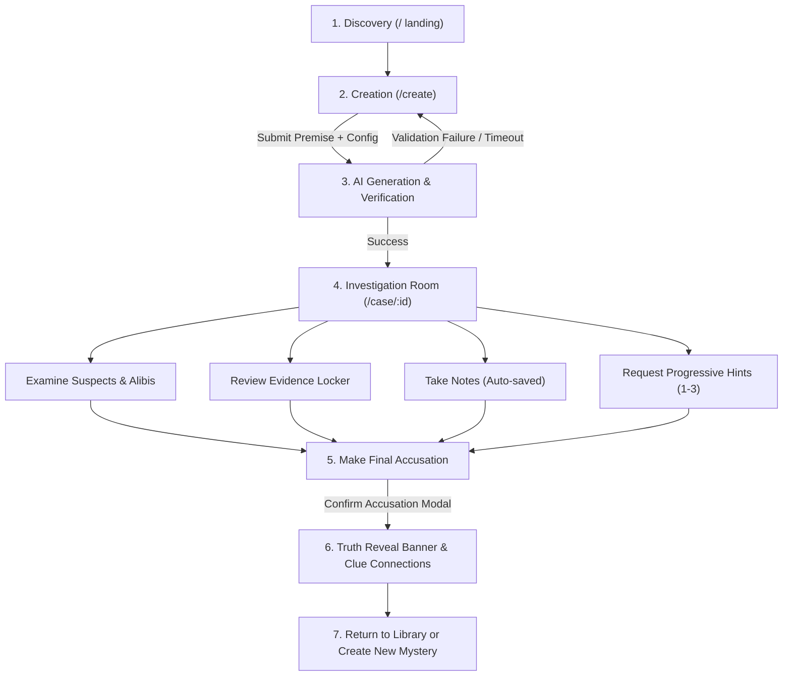

# Product Requirements Document (PRD) — AI Mystery Room

**Document Version:** 2.1  
**Project:** AI Mystery Room  
**Status:** Implemented Baseline / In Production Readiness  
**Target Platform:** Web (Desktop & Mobile Responsive)  
**Primary Tech Stack:** Node.js, Express, MongoDB (Mongoose), React 18, Vite, Google Gemini API  

---

## 1. Executive Summary & Product Vision

**AI Mystery Room** is an interactive, browser-based detective investigation game powered by generative AI (Google Gemini API). Players step into fictional mystery scenarios—generated either from custom prompts or curated random premises—and examine suspects, witness statements, physical clues, simulated CCTV footage, and chronological timelines to deduce the true culprit.

### Core Principle
> **"Easy to start. Engaging to investigate. Satisfying to solve."**

### Strategic Objectives
1. **Zero-Friction Onboarding:** Players launch straight into an investigation without mandatory account registration, passwords, or credit cards.
2. **Logical Rigor:** Mysteries maintain rock-solid internal consistency. The AI must produce a deterministic canonical solution containing a motive, method, evidence connections, and alibi invalidations before the player sees any clues.
3. **Information Security & Anti-Cheat:** The canonical solution is stored in an isolated database collection and is strictly withheld from client-side network payloads until a valid, final accusation is submitted.
4. **Cultural & Linguistic Inclusivity:** Full first-class support for English, Hindi (Devanagari script), and Hinglish (phonetic Romanized Hindi).
5. **Session Resilience:** Player progress (evidence review flags, free-text detective notes, hints requested, accusation outcomes) persists across page refreshes and browser restarts for up to 30 days via signed anonymous sessions.

---

## 2. Target Audience & User Personas

### 2.1 Primary Audience
- **Casual Mystery & Puzzle Fans:** Players who enjoy escape rooms, whodunit fiction (Agatha Christie, Sherlock Holmes), murder mystery board games, and deduction video games (e.g., *Ace Attorney*, *Return of the Obra Dinn*).
- **Casual Mobile & Desktop Gamers:** Users seeking quick 5–20 minute engaging narrative experiences during commutes or leisure time.
- **Narrative AI Enthusiasts:** Users intrigued by dynamic, AI-crafted stories that react to user creativity.

### 2.2 Secondary Audience
- **Hindi & Hinglish Speakers:** South Asian users who prefer engaging with interactive narrative games in their mother tongue or everyday colloquial hybrid language.
- **Creative Writers:** Players testing bespoke mystery premises (e.g., "A stolen rare flower in a sealed botanical dome").

### 2.3 UX Principles & Non-Negotiables
- **No Mandatory Login:** Immediate playability via signed HTTP cookies.
- **No Manipulative Mechanics:** No artificial energy bars, cooldown microtransactions, punitive paywalls, or deceptive streaks.
- **No Premature Revelation:** The interface will never reveal or hint at the culprit through client-side state inspection or DOM attributes.

---

## 3. Product Scope & Phasing

### 3.1 MVP Scope (Implemented & Baseline)
The current repository delivers the complete core MVP:
- **Discover & Landing:** Hero landing page with mystery aesthetics, high-level walkthrough ("How It Works"), trust badge (fictional declaration), and language selector.
- **Case Intake & Creation:**
  - Custom premise input (30 to 1,000 characters) with real-time character counter and safety screening against real-world allegations.
  - "Surprise Me" random premise selector across 6 categories: General, Locked Room, Art Theft, Disappearance, Historical, Espionage.
  - Difficulty selection: Easy (3 suspects, 4–5 clues, 0–1 red herrings), Medium (4 suspects, 6–7 clues, 1–2 red herrings), Hard (5 suspects, 8–10 clues, 2–3 red herrings).
  - Case length selection: Short, Medium, Long.
  - Language selection: English (`en`), Hindi (`hi`), Hinglish (`hinglish`).
- **Investigation Room (`/case/:caseId`):**
  - Tabbed workspace: Case Briefing & Scene, Suspects Dossier, Evidence Locker, Detective Notes (auto-saving notepad), Hints System.
  - Persistent bottom accusation bar with confirmation modal.
  - Modal view for inspectable evidence with "Mark as Reviewed" status tracking.
  - Interactive onboarding tutorial walkthrough (stored in browser local storage).
- **Progressive Hints System:**
  - Up to 3 ordered hints per case: Level 1 (Nudge), Level 2 (Connection), Level 3 (Strong Hint).
  - Dynamically grounded in validated evidence from the server's private solution model.
  - Strict sequential unlocking enforcement (cannot jump from Level 1 to Level 3).
- **Accusation & Truth Reveal:**
  - Exactly one final accusation per case.
  - Atomic server-side evaluation against the canonical solution.
  - Idempotent reveal displaying culprit identity, motive, method, full narrative explanation, and per-clue evidence deductions.
  - Dynamic on-the-fly translation of reveal text if the user switches languages in the completed room.
- **Investigation Library (`/library`):**
  - Listing of all cases tied to the player's 30-day anonymous session.
  - Direct resume links and case deletion capability.
- **Security & Infrastructure Safeguards:**
  - Separation of `MysteryCase` and `CaseSolution` database records.
  - Signed HMAC-SHA256 session cookies (`mystery_session`).
  - Rate limiting on case generation, hints, progress updates, and accusations.
  - Input sanitization, strict Zod schema parsing, XSS mitigation (no `dangerouslySetInnerHTML`).

### 3.2 Post-MVP / Future Roadmap (Non-MVP)
The following items are explicitly categorized as **Future Phases** and must not delay the MVP baseline:
- Registered user accounts (email/password, OAuth, Google sign-in) with account recovery.
- Cross-device case syncing.
- Cosmetic achievements, detective badges, and ranks.
- Interactive drag-and-drop corkboard / mind-map evidence board.
- AI-generated evidence imagery and audio ambient soundscapes.
- Community case sharing, public rating, and leaderboard rankings.
- Multi-attempt accusation mechanics.

---

## 4. User Journeys & Core Loops

### Stage 1: Discovery (`/`)
- User lands on the home page.
- Sees brand identity, tagline, three-step guide ("Set the scene", "Follow the evidence", "Name your suspect"), and fictionality assurance.
- Selects preferred language (English / Hindi / Hinglish) or enters the library if prior investigations exist.
- Clicks **Start investigating** or **Create a mystery**.

### Stage 2: Mystery Creation (`/create`)
- Chooses between custom premise or "Surprise Me" (random).
- If custom: Types between 30 and 1,000 characters. Input is screened locally and server-side to reject real-person defamatory allegations.
- Selects Category, Difficulty (Easy, Medium, Hard), Length (Short, Medium, Long), and Language.
- Submits request. UI displays a spinner with contextual status messages.

### Stage 3: Investigation (`/case/:caseId`)
- Player reviews the incident overview, location, date/time, and primary objective.
- Explores suspects: names, roles, profiles, relationships, and alibis.
- Explores evidence items: text messages, witness statements, documents, photos, simulated CCTV logs.
- Clicks clues to open an evidence modal, reading full details and marking items as "Reviewed".
- Drafts hypotheses in an auto-saving private notepad (debounced PATCH calls).
- When stuck, unlocks hints in strict 1 -> 2 -> 3 sequence.

### Stage 4: Accusation & Reveal
- Player selects a suspect and clicks **Make final accusation**.
- A modal demands confirmation, warning that the investigation will be concluded permanently.
- Upon confirmation, server records `submittedSuspectId`, matches it with `CaseSolution.culpritId`, locks the case, and returns the full reveal payload.
- Reveal view displays:
  - Correct / Incorrect verdict banner.
  - Culprit name, motive, method, and comprehensive solution narrative.
  - Clue breakdown: which evidence supported the culprit, which weakened suspects, and which were red herrings.

---

## 5. Success Metrics & Key Performance Indicators (KPIs)

| Metric | Target | Measurement Method |
|---|---|---|
| **Case Generation Success Rate** | > 95% on first attempt; > 99% within 3 bounded retries | Server JSON logs (`case_generation_success` vs `case_generation_failed`) |
| **P95 Generation Latency** | < 25 seconds (using Gemini thinking-level `low`) | Server response timing headers and telemetry logs |
| **Accusation Completion Rate** | > 40% of generated cases reach an accusation | Ratio of cases with `status: completed` to total generated cases |
| **Leak Prevention Rate** | 100% (0 culprit disclosures prior to accusation) | Automated regression test assertions on public API schemas |
| **Client Crash / Unhandled Error Rate** | < 0.5% of sessions | Browser error logging and API 500 error monitoring |
| **Localization Fidelity** | 100% script consistency (Hindi has Devanagari; Hinglish has Latin words; no script mixing) | Regex checks in `validateReferences` |

---

## 6. Regulatory, Safety & Ethics Constraints

1. **Purely Fictional Declarations:** Prominent badges on landing, creation, and room pages state that all characters, incidents, and evidence are fictitious.
2. **Defamation & Real-World Safeguards:** Server-side regex pattern `realTarget` rejects scenarios naming real employers, politicians, celebrities, teachers, spouses, or acquaintances.
3. **Non-Graphic Content Guidelines:** System prompts instruct Gemini to avoid graphic violence, sexual abuse, or disturbing gore, maintaining a classic detective fiction rating.
4. **Data Privacy (No PII):** No email, phone number, IP address, or real names are stored. Anonymous sessions are hashed and automatically scrubbed after 30 days via database TTL indexes.

