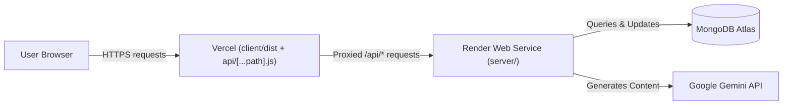

# Developer Environment & Setup Guide — AI Mystery Room

**Document Version:** 2.1  
**Project:** AI Mystery Room  
**Status:** Implemented Baseline  

---

## 1. System Requirements

Before setting up AI Mystery Room locally or in production, ensure your environment meets the following specifications:

- **Node.js:** Version 20.0.0 or higher (supports native `fetch`, native `node:test`, and ECMAScript Modules).
- **Package Manager:** `npm` 10+ (bundled with Node.js 20).
- **Database:** MongoDB 6.0+ (local Community Server or MongoDB Atlas cluster).
- **AI Credentials:** Google Gemini API key (available from [Google AI Studio](https://aistudio.google.com/)).
- **Operating System:** Windows, macOS, or Linux.

---

## 2. Step-by-Step Local Setup

### Step 1: Clone Repository
```bash
git clone <repository-url>
cd "AI Mystery Room"
```

### Step 2: Install Dependencies
The repository consists of a root orchestrator, a server workspace, and a client workspace:
```bash
# Install root orchestration tools (concurrently)
npm install

# Install backend dependencies (express, mongoose, zod, etc.)
npm install --prefix server

# Install frontend dependencies (react, react-router, lucide-react, vite)
npm install --prefix client
```

### Step 3: Configure Environment Variables
Copy the root `.env.example` file to `.env`:
```bash
cp .env.example .env
```

Open `.env` in your editor and configure the values:
```env
# Server Runtime
NODE_ENV=development
PORT=5000
CLIENT_ORIGIN=http://localhost:5173
TRUST_PROXY_HOPS=0
MONGODB_URI=mongodb://127.0.0.1:27017/ai_mystery_room
MONGODB_DNS_SERVERS=
SESSION_SECRET=your_super_secret_session_key_with_at_least_32_characters

# Gemini AI Credentials
GEMINI_API_KEY=your_google_ai_studio_api_key_here
GEMINI_MODEL=gemini-2.5-flash
GEMINI_THINKING_LEVEL=low
GEMINI_TIMEOUT_MS=90000
GEMINI_MAX_RETRY_DELAY_MS=30000

# Operational Limits
CASE_GENERATION_RATE_LIMIT=5
CASE_GENERATION_RATE_WINDOW_MINUTES=60
MAX_CONCURRENT_GENERATIONS=2
CASE_PROGRESS_RATE_LIMIT=120
CASE_PROGRESS_RATE_WINDOW_MINUTES=15
CASE_ACCUSATION_RATE_LIMIT=10
CASE_ACCUSATION_RATE_WINDOW_MINUTES=15
CASE_HINT_RATE_LIMIT=12
CASE_HINT_RATE_WINDOW_MINUTES=15
MAX_SCENARIO_LENGTH=1000
```

> [!WARNING]
> Never add a `VITE_` prefix to `GEMINI_API_KEY` or `SESSION_SECRET`. These secrets must remain strictly on the server and must never be exposed to client bundles.

### Step 4: Start MongoDB
Ensure MongoDB is running locally:
```bash
# On Linux/macOS (systemd or brew)
sudo systemctl start mongod
# or: brew services start mongodb-community

# On Windows
net start MongoDB
```

### Step 5: Start the Development Server
Run both client and server concurrently from the repository root:
```bash
npm run dev
```

- **Frontend:** Accessible at `http://localhost:5173`
- **Backend API:** Accessible at `http://localhost:5000/api`
- Vite automatically proxies `/api` calls from port 5173 to port 5000 in development.

---

## 3. Environment Variables Reference Table

| Variable | Scope | Required | Default | Purpose / Allowed Values |
|---|---|---|---|---|
| `NODE_ENV` | Backend | Yes | `development` | `'development'` or `'production'`. In production, activates strict SSL and origin checks. |
| `PORT` | Backend | No | `5000` | Port for the Express server to listen on. |
| `CLIENT_ORIGIN` | Backend | Yes | `http://localhost:5173` | Allowed origin for CORS and CSRF origin mutation validation. |
| `TRUST_PROXY_HOPS` | Backend | No | `0` | Number of trusted reverse proxy hops (0 to 5) for IP resolution. |
| `MONGODB_URI` | Backend | Yes | `mongodb://127.0.0.1:27017/ai_mystery_room` | MongoDB connection string. |
| `MONGODB_DNS_SERVERS` | Backend | No | `""` | Comma-separated list of up to 3 DNS resolver IPs (e.g., `8.8.8.8,1.1.1.1`). |
| `SESSION_SECRET` | Backend | Yes | Dev default | Random secret for HMAC-SHA256 cookie signing (minimum 32 characters in production). |
| `GEMINI_API_KEY` | Backend | Yes | `""` | Google AI Studio API key. |
| `GEMINI_MODEL` | Backend | Yes | `""` | Identifier for the Gemini model (e.g., `gemini-2.5-flash`, `gemini-3.5-flash-lite`, `gemini-3.8-flash`). |
| `GEMINI_THINKING_LEVEL` | Backend | No | `low` | Thinking budget for Gemini 3+ models (`minimal`, `low`, `medium`, `high`). |
| `GEMINI_TIMEOUT_MS` | Backend | No | `90000` | Per-request Gemini HTTP timeout in ms (max 180,000). |
| `GEMINI_MAX_RETRY_DELAY_MS` | Backend | No | `30000` | Max delay the server will sleep before skipping an upstream retry. |
| `CASE_GENERATION_RATE_LIMIT` | Backend | No | `5` | Max case generations allowed per window. |
| `CASE_GENERATION_RATE_WINDOW_MINUTES` | Backend | No | `60` | Generation rate limit window in minutes. |
| `MAX_CONCURRENT_GENERATIONS` | Backend | No | `2` | Max concurrent active LLM generation requests before returning 429 busy. |
| `API_ORIGIN` | Vercel Edge | Yes (Prod) | `""` | Target HTTPS backend origin for the Vercel serverless proxy (`client/api/[...path].js`). |

---

## 4. Development & Build Commands

| Command | Working Directory | Description |
|---|---|---|
| `npm run dev` | Root | Starts both backend (`node --watch`) and frontend (Vite) via `concurrently`. |
| `npm --prefix server run dev` | Root | Starts backend only with automatic file watching (`node --watch src/server.js`). |
| `npm --prefix client run dev` | Root | Starts Vite frontend dev server at `http://localhost:5173`. |
| `npm run build` | Root | Builds the production Vite bundle to `client/dist`. |
| `npm test` | Root | Runs backend unit/integration tests and client security tests. |
| `npm --prefix server test` | Root | Runs Node built-in test runner for backend tests (`node --test`). |
| `npm --prefix client test` | Root | Runs client security and i18n unit tests. |
| `npm --prefix client run test:e2e` | Root | Executes Playwright end-to-end acceptance tests. |
| `npm start` | Root | Starts production backend (`node src/server.js`). |

---

## 5. Production Deployment Architecture



### 5.1 Backend Deployment (Render)
1. Create a new **Web Service** on Render connected to this repository.
2. Configure settings:
   - **Root Directory:** `server`
   - **Environment:** `Node`
   - **Build Command:** `npm ci`
   - **Start Command:** `npm start`
   - **Health Check Path:** `/api/health`
3. Add environment variables:
   - `NODE_ENV`: `production`
   - `CLIENT_ORIGIN`: Your production Vercel URL (e.g., `https://mystery-room.vercel.app`)
   - `MONGODB_URI`: Atlas connection string
   - `SESSION_SECRET`: Generated 32+ character random string
   - `GEMINI_API_KEY`: Production Gemini API key
   - `GEMINI_MODEL`: `gemini-2.5-flash` (or your chosen model)

### 5.2 Frontend Deployment (Vercel)
1. Import repository into Vercel.
2. Configure project settings:
   - **Root Directory:** `client`
   - **Framework Preset:** `Vite`
   - **Build Command:** `npm run build`
   - **Output Directory:** `dist`
3. Add environment variable:
   - `API_ORIGIN`: Exact HTTPS origin of the Render backend (e.g., `https://ai-mystery-room-api.onrender.com`).
4. Vercel automatically deploys the serverless API proxy (`client/api/[...path].js` configured with `maxDuration: 60` to accommodate AI synthesis latency) and static SPA rewrites (`client/vercel.json`).

---

## 6. Troubleshooting Common Setup Issues

| Problem | Root Cause | Solution |
|---|---|---|
| `MongooseServerSelectionError: connect ECONNREFUSED 127.0.0.1:27017` | Local MongoDB daemon is not running. | Start MongoDB using `net start MongoDB` or `brew services start mongodb-community`. |
| `AI_PROVIDER_ERROR (502)` / `GENERATION_UNAVAILABLE (503)` | `GEMINI_API_KEY` is missing or invalid in `.env`. | Verify key in Google AI Studio and ensure it is placed in root `.env` under `GEMINI_API_KEY`. |
| `ORIGIN_NOT_ALLOWED (403)` | Mutation request origin does not match `CLIENT_ORIGIN`. | Ensure `CLIENT_ORIGIN` matches your Vite dev server port (default `http://localhost:5173`). |
| `SESSION_SECRET must be at least 32 characters` | Production mode requires a cryptographically strong secret. | Set `SESSION_SECRET` to a string of 32+ characters without words like `replace` or `changeme`. |
| `DNS query failed for mongodb+srv://` | Network or container cannot resolve Atlas SRV DNS records. | Add `MONGODB_DNS_SERVERS=8.8.8.8,1.1.1.1` to `.env`. |

