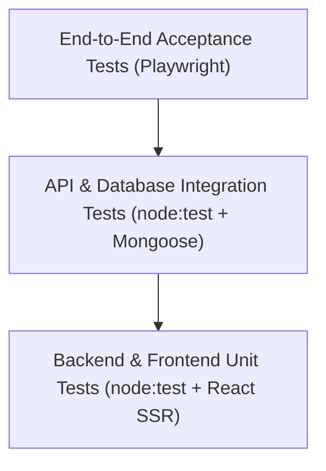

# Testing Strategy & Quality Assurance — AI Mystery Room

**Document Version:** 2.1  
**Project:** AI Mystery Room  
**Status:** Implemented Baseline  
**Test Frameworks:** Node.js Native Test Runner (`node:test`, `node:assert/strict`) + Playwright (`@playwright/test`)  

---

## 1. Testing Philosophy & Test Pyramid

AI Mystery Room enforces a multi-tier testing pyramid designed for deterministic quality and zero regression:



1. **Deterministic Unit Tests:** Execute quickly in sub-second time without external network access or live LLM API calls.
2. **Security & Regression Verifications:** Prevent solution disclosure leaks, verify cryptographic cookie tamper detection, and test against XSS injection payloads.
3. **End-to-End Acceptance:** Test complete user journeys across real browser DOM elements using Playwright.

---

## 2. Test Suites Catalog

### 2.1 Backend Unit & Logic Tests (`server/test/`)

| Test File | Description | Assertions & Scenarios |
|---|---|---|
| `sessionSecurity.test.js` | Anonymous session cookie validation. | Confirms token format (`v2.<id>.<exp>.<sig>`), HttpOnly, SameSite=Lax, Secure flags, expiration bounds (<=30 days), and rejection of tampered tokens. |
| `caseValidation.test.js` | Scenario input & Gemini validation logic. | Tests premise length (30–1,000 chars), category enums, duplicate suspect names, invalid culprit references, red-herring limits, ISO-8601 timestamps, chronological timeline order, Hindi Devanagari ratio, Latin script purity, and culprit leak regexes. |
| `caseValidation.test.js` (Self-Repair) | Gemini self-repair engine. | Mocks `fetchTransport` to feed malformed JSON and verifies the model repairs itself within 3 attempts. |
| `errorMapping.test.js` | Upstream provider error classification. | Verifies that upstream Gemini 429 quota exhaustion maps cleanly to `AI_RATE_LIMITED` with preserved `Retry-After` headers. |
| `randomPremises.test.js` | Premise repository validation. | Confirms all 6 categories (General, Locked Room, Art Theft, Disappearance, Historical, Espionage) return valid non-empty seed strings. |

### 2.2 Backend Integration Test (`server/test/caseFlow.test.js`)

- **Requirements & Resilience:** Connects to `mongodb://127.0.0.1:27017/ai_mystery_room_e2e` with a 2-second timeout. If MongoDB is unreachable on the host environment (such as standard offline developer sandboxes without a daemon), the test runner gracefully skips the integration test with an informational notice, preserving 100% green unit test runs (`exit code 0`). In CI environments configured with a MongoDB service container, the test executes automatically.
- **Flow Verified:**
  1. `POST /api/cases` creates a case and issues signed session cookie.
  2. Asserts `publicCase` payload **excludes** culprit identity, motive, and `CaseSolution`.
  3. `PATCH /api/cases/:id/progress` updates notes and marks evidence reviewed.
  4. `POST /api/cases/:id/hints` unlocks Hint 1, then Hint 2 in strict sequence.
  5. `POST /api/cases/:id/accusation` submits final deduction.
  6. Confirms investigation transitions to `completed` and returns full reveal.
  7. Confirms repeated calls are idempotent and cannot alter progress.

### 2.3 Client Security & Configuration Tests (`client/test/`)

| Test File | Description | Assertions & Scenarios |
|---|---|---|
| `xss.test.js` | Untrusted evidence rendering security. | Uses React Server Side Rendering (`renderToStaticMarkup`) with `` payloads to verify `PlainText` escapes HTML characters. |
| `vercelConfig.test.js` | Vercel Edge proxy configuration. | Validates `/api/:path*` rewrites, CSP response headers, and rejection of insecure/malformed `API_ORIGIN` strings. |
| `i18n.test.js` | Internationalization & localized error mapping. | Verifies English, Hindi, and Hinglish error messages for rate limits, session errors, and quota exhaustion. |

### 2.4 End-to-End Acceptance Tests (`client/e2e/case-acceptance.spec.js`)

Uses Playwright to automate a full browser session:
1. Loads Landing page and navigates to `/create`.
2. Fills custom premise and generates a case.
3. Steps through the onboarding tutorial dialog.
4. Switches tabs between Case, Suspects, Evidence, and Notes.
5. Opens evidence modals, verifies metadata, and toggles "Mark as Reviewed".
6. Unlocks progressive hints.
7. Selects a suspect and confirms the accusation in the modal.
8. Asserts the truth reveal banner and clue reasoning breakdown appear.

---

## 3. Running Tests

### Run All Unit & Client Tests
```bash
npm test
```
*Executes `npm --prefix server test` followed by `npm --prefix client test`.*

### Run Backend Tests Only
```bash
npm --prefix server test
```

### Run Client Tests Only
```bash
npm --prefix client test
```

### Run Playwright End-to-End Tests
Ensure both server and client dev servers are running, then:
```bash
npm --prefix client run test:e2e
```

---

## 4. CI/CD Quality Gates & Automation Checklist

Before any release or deployment:
- [ ] `npm test` runs with **100% pass rate**.
- [ ] `npm run build` generates `client/dist` with 0 bundle warnings.
- [ ] `npm audit` reports 0 critical or high vulnerabilities in root, server, and client.
- [ ] No Gemini API keys or session secrets committed to git.
- [ ] Verification that `CaseSolution` fields never appear in public API payloads.

